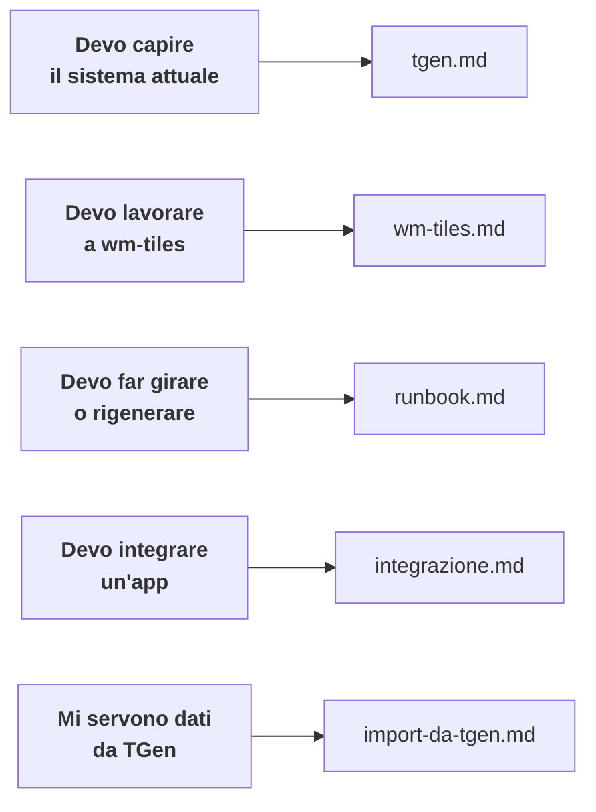

# Documentazione wm-tiles

Server di tiles **vettoriali** da OpenStreetMap che sostituisce le tiles
raster servite oggi da `api.webmapp.it/tiles`, mantenendo la stessa carta.

---

## Da dove cominciare

| documento | per chi |
|---|---|
| [**tgen.md**](tgen.md) | chi deve capire il sistema che stiamo sostituendo |
| [**wm-tiles.md**](wm-tiles.md) | chi lavora al server o allo stile |
| [**runbook.md**](runbook.md) | chi deve far girare il sistema o rigenerare dati |
| [**integrazione.md**](integrazione.md) | chi integra webapp, app o `map-core` |
| [**import-da-tgen.md**](import-da-tgen.md) | chi deve leggere dati da TGen |

`CLAUDE.md`, nella radice del repo, raccoglie i vincoli del committente e le
trappole verificate sul campo: è pensato per chi (o cosa) scrive codice, non
come introduzione.

---

## Lo stato, in breve

**Fatto**: il servizio, la pipeline dei dati, lo stile vettoriale che
riproduce l'aspetto del riferimento, la preview di confronto, il filtro dei
livelli per app.

**Non ancora**: renderer raster, pipeline nazionale, rigenerazione
schedulata, connettore `map-core`, osservabilità.

L'area generata copre l'Appennino Tosco-Emiliano e il Monte Pisano
(`10,0 43,62 10,9 44,5`). Sulla scala z10–z16 la somiglianza al riferimento è
entro **±2,5 di luminosità** e **±1,8 di contrasto**.

---

## I tre vincoli che non si negoziano

1. **TGen è sola lettura.** È un server di produzione: solo `SELECT`,
   `COPY … TO STDOUT` e `tar cf -` su stdout, query passate da stdin, ogni
   comando mostrato e approvato prima di eseguirlo.
2. **Niente raster come sfondo di mappa.** Uso suolo, curve di livello e
   ombreggiatura sono vettoriali o calcolati. L'unica eccezione è il DEM come
   sorgente `raster-dem`: quelle tile codificano *quote*, non pixel di mappa.
3. **Il frontend è OpenLayers.** MapLibre non sarà usato in produzione: ogni
   soluzione lato client va verificata in OpenLayers.

---

## Una nota sul metodo

L'obiettivo dichiarato è la **verosimiglianza alle tiles PNG attuali**, non la
fedeltà al CartoCSS di TGen. Quando i due divergono — succede, perché le
tiles sono più vecchie dello stile — **vince il PNG**.

E si confronta lo **stile**, non il contenuto: le tiles di riferimento sono
ferme da mesi mentre OpenStreetMap è andato avanti, quindi una strada in più o
un edificio in meno sono attesi. Conta come sono disegnate le cose presenti in
entrambi.
