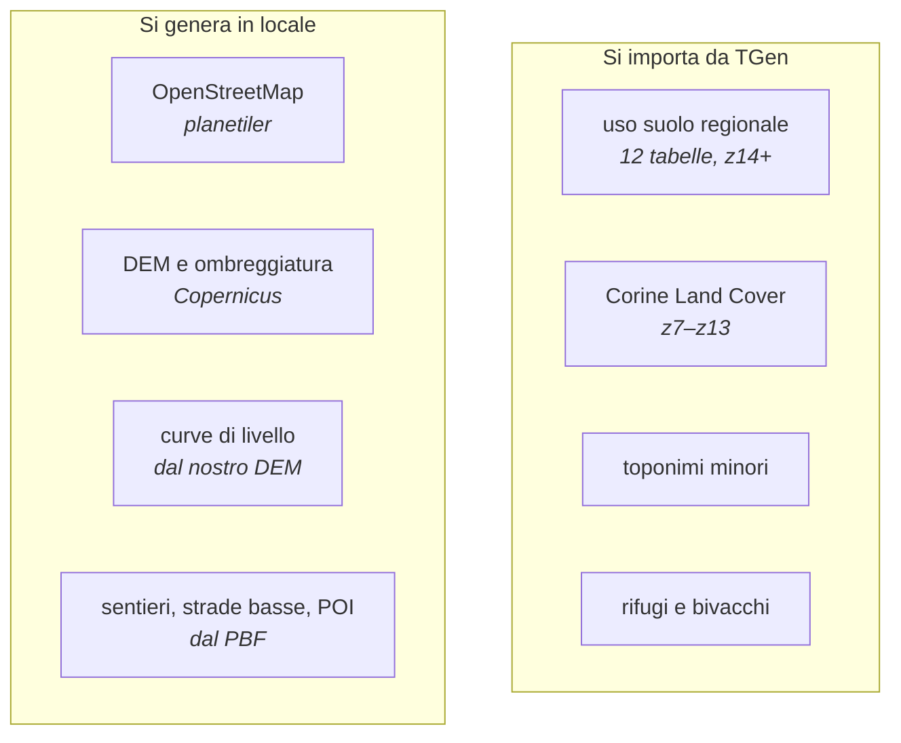
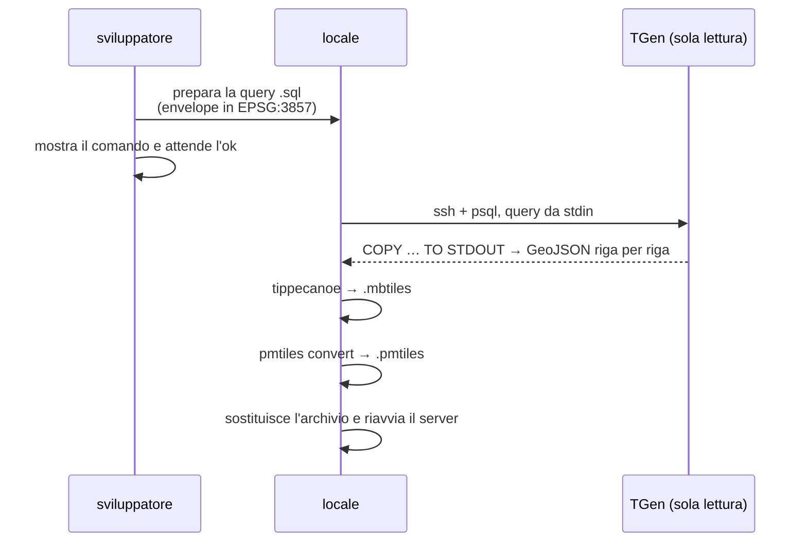

# Importare dati da TGen

I dati cartografici migliori — uso suolo regionale, curve di livello,
toponimi, rifugi — vivono su [TGen](tgen.md). wm-tiles li legge, non li
rigenera da zero.

---

## La regola, prima di tutto

> **TGen è un server di produzione. Per noi è in sola lettura.**
>
> Sono ammessi soltanto:
> - `SELECT`
> - `COPY … TO STDOUT`
> - `tar cf -` su stdout
>
> **Vietati**: qualunque scrittura, creare file sul server, riavviare
> servizi, salvare query là. Le query si passano da **stdin**.
>
> **Ogni comando SSH va mostrato e approvato prima di eseguirlo.**

Non è una cautela tecnica: è una decisione del committente. Violarla invalida
il lavoro.

```bash
# la forma corretta: la query entra da stdin, il risultato esce sul nostro disco
ssh tgen "psql -d general -Atf -" < pipeline/sql/usotoscana-bbox.sql \
  > data/usotoscana.geojsonl
```

---

## Cosa si importa, e cosa no



**Le curve di livello sono passate da importate a generate.** L'archivio
importato copriva un riquadro fisso e non si estendeva; `build-contours-tipizzate.sh`
le produce dal nostro DEM replicando la convenzione di TGen (`quota` e `type`,
con `cp` per le direttrici ogni 100 m e `cs` per le secondarie), quindi
coprono qualunque area senza dipendere da un accesso esterno.

---

## Il flusso di un'importazione



Tutto ciò che segue la lettura avviene **in locale**: TGen vede solo una
`SELECT`.

---

## Le query

Stanno in `pipeline/sql/`. Ognuna fa tre cose:

1. **normalizza le colonne**: ogni regione ha nomi propri (`lv3_13`,
   `cod_tot`, `ur_cd`…), un `CASE` li traduce nel `coduso` che lo stile
   conosce
2. **riproietta a EPSG:4326** con `ST_Transform`
3. **ritaglia sul riquadro** con `ST_MakeEnvelope` in EPSG:3857

```sql
COPY (
  SELECT json_build_object(
    'type','Feature',
    'properties', json_build_object('coduso', d.coduso, 'src', 'usotoscana'),
    'geometry', ST_AsGeoJSON(ST_Transform(d.geom, 4326))::json)::text
  FROM ( SELECT gid, geom,
           CASE WHEN lv3_13 IN ('311') THEN 'blatifoglie'
                WHEN lv3_13 IN ('313') THEN 'bosco'
                …
           END AS coduso
         FROM usotoscana2013 ) AS d
  WHERE d.geom && ST_MakeEnvelope(1113195, 5405357, 1213382, 5543148, 3857)
) TO STDOUT
```

**Per una nuova area cambia solo l'envelope.** Le coordinate sono in
EPSG:3857 (metri), non in gradi:

```python
import math
R = 6378137
x = lambda lon: R * math.radians(lon)
y = lambda lat: R * math.log(math.tan(math.pi/4 + math.radians(lat)/2))
# 10.0, 43.62, 10.9, 44.5  →  1113195, 5405357, 1213382, 5543148
```

---

## Dopo l'importazione

```bash
tippecanoe -o /tmp/lc.mbtiles -l landcover -Z8 -z14 \
  --drop-densest-as-needed --simplification=4 --force -q data/usotoscana.geojsonl
pmtiles convert /tmp/lc.mbtiles data/archives/<versione>/landcover.pmtiles
```

Poi si riavvia il server. **Conserva sempre l'archivio precedente** con un
nome parlante (`landcover-solo-nord.pmtiles`): se il nuovo copre meno del
vecchio, te ne accorgi confrontandoli invece di scoprirlo dalla mappa.

### Verificare la copertura

Il modo più rapido di sapere se un archivio copre un'area è leggerne il
riquadro dall'intestazione PMTiles:

```bash
node -e "
const {PMTiles}=require('pmtiles'), fs=require('fs');
const path='data/archives/<versione>/landcover.pmtiles', buf=fs.readFileSync(path);
new PMTiles({getKey:()=>path,getBytes:async(o,l)=>({data:new Uint8Array(buf.subarray(o,o+l)).buffer})})
  .getHeader().then(h=>console.log(h.minLon,h.minLat,h.maxLon,h.maxLat));"
```

**Non tutti gli archivi hanno lo stesso riquadro.** `clc`, `toponimi` e
`rifugi` sono stati importati con un riquadro quasi nazionale e coprono già
qualunque area italiana; l'uso suolo **regionale** segue il riquadro
dell'importazione, e per un'area nuova va riletto.

---

## Trappole verificate

**Il nome della tabella nel `.mml` non è quello reale.** `usotoscana` →
`usotoscana2013`, `usoemilia` → `uso_emilia_2008`. Il `.mml` usa alias.

**Le colonne differiscono fra regioni.** Non esiste una query unica: ognuna ha
la sua traduzione in `coduso`.

**`ssh` avvisa sulla crittografia post-quantistica.** È un avviso del client,
non un errore: la lettura riesce.

**Riscarica l'intero riquadro, non solo la fascia mancante.** Unire due
importazioni con riquadri diversi lascia una giuntura dove i poligoni non
combaciano; rileggere tutto costa qualche minuto e dà un dato coerente.

---

## Cosa serve per un'area nuova

| dato | serve importare? |
|---|---|
| uso suolo regionale (z14+) | **sì**, segue il riquadro |
| Corine (z7–z13) | no, riquadro quasi nazionale |
| toponimi, rifugi | no, riquadro quasi nazionale |
| curve di livello | no, si generano dal nostro DEM |
| OSM, DEM, sentieri, POI | no, tutto locale |

In pratica: **una sola importazione**, quella dell'uso suolo della regione
interessata.
