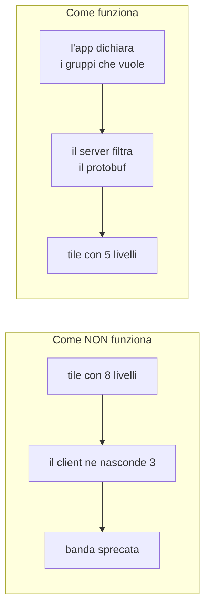
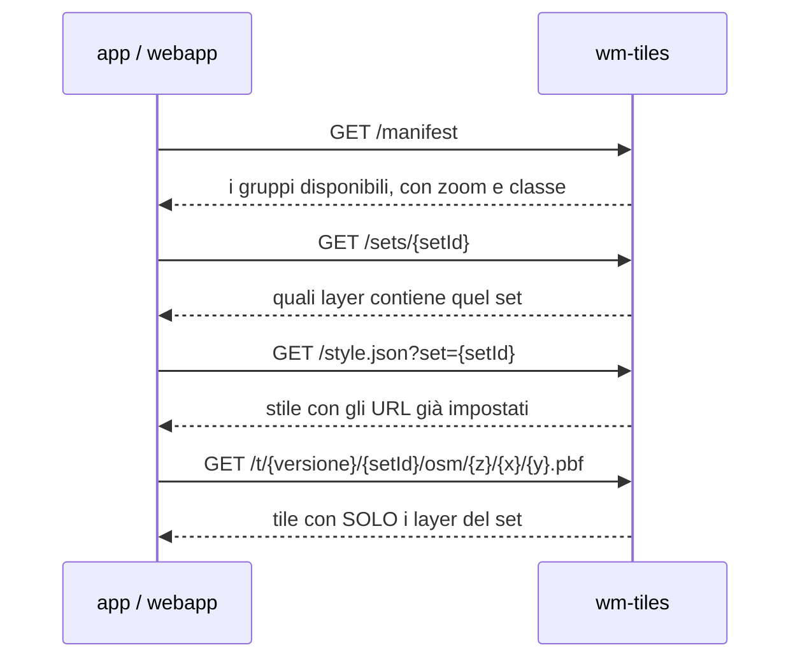

# Integrazione — chi espone cosa

Come webapp, app e `map-core` consumano wm-tiles, e come un'app decide quali
livelli vedere.

> Aggiornato al 5 settembre 2026. Il connettore `map-core` **non è ancora
> stato scritto**: quanto segue descrive il contratto lato server, che è
> pronto e verificabile oggi con `curl`.

---

## Il problema che risolve

Ogni app di ogni shard mostra una carta diversa: una vuole i sentieri, una i
rifugi, una nessuno dei due. Con le tiles raster non c'è scelta — l'immagine
è cotta, e o la si prende tutta o niente.

La richiesta era esplicita: **se un'app mostra 5 livelli su 8, il backend deve
mandarne 5**, non tutti con tre nascosti dal client. Altrimenti si paga banda
per dati che nessuno vedrà.



---

## I gruppi di livelli

Il manifest (`manifest/layers.v1.json`) dichiara **gruppi**, non singoli
layer: è l'unità che un'app accende o spegne.

| gruppo | zoom | contenuto |
|---|---|---|
| `base` | z0–14 | acque, corsi d'acqua, uso suolo di base |
| `landcover` | z8–14 | uso suolo regionale e Corine |
| `roads` | z4–14 | viabilità |
| `buildings` | z13–14 | edifici |
| `places` | z0–14 | toponimi principali |
| `poi` | z12–14 | punti d'interesse |
| `contours` | z11–14 | curve di livello |
| `peaks` | z7–14 | cime |
| `hiking` | z10–14 | sentieri numerati |
| `toponimi` | z9–14 | toponimi minori |
| `rifugi` | z10–14 | rifugi e bivacchi |
| `osmpoi` | z11–14 | cime, valichi, sorgenti da OSM |

Ogni gruppo dichiara anche una `class` (`public` o riservata) e gli attributi
che espone.

---

## Come un'app chiede la sua carta

L'insieme dei gruppi si identifica con un **`setId`**: le prime 12 cifre
dell'hash SHA-256 dei nomi dei gruppi, ordinati.



### Quale stile chiedere

`wm-tiles` serve lo stesso stile in due forme, una per renderer:

| Indirizzo | Per chi | Differenza |
|---|---|---|
| `/style.json` | come prima: è `/style-openlayers.json` | — |
| `/style-openlayers.json` | OpenLayers, il frontend Webmapp | `tileSize: 256` su ogni sorgente vettoriale |
| `/style-maplibre.json` | MapLibre GL JS e MapLibre Native | nessun `tileSize` sulle vettoriali |

Le tile sono **le stesse**: identici gli URL, le sorgenti e i layer. Cambia solo
ciò che lo stile dichiara, perché i due renderer contano i livelli di zoom in
modo diverso. OpenLayers costruisce le sorgenti vettoriali su una griglia da
512 px e a vista z13 chiederebbe le tile z12, un livello meno del riferimento
raster: il 256 lo riallinea. MapLibre col suo default, 512, è già allineato, e
rifiuta qualunque altro valore con *vector tile sources must have a tileSize of
512* lasciando la mappa vuota. Il `raster-dem` del terrain resta a 256 in
entrambi: lì il campo è legittimo.

Il parametro `?set=` vale su tutti e tre gli indirizzi.

Il `setId` è **deterministico**: gli stessi gruppi danno sempre lo stesso
identificativo, da qualunque client. Non serve un registro condiviso né una
chiamata di registrazione — l'app calcola l'hash e lo usa.

Un `setId` sconosciuto non è un errore: il server ripiega sul set completo e
lo annota nei log.

---

## Il filtro lavora sui byte

Il pezzo che rende tutto questo praticabile sta in `src/tiles/filter.js`.

Filtrare una tile vettoriale nel modo ovvio significa decodificare il
protobuf, togliere i layer, ricodificare — costoso e con rischio di perdere
precisione nelle geometrie. Qui invece **si tagliano i byte del protobuf**:
un layer è un campo di primo livello del messaggio, quindi si scorre la
struttura e si copiano solo i campi voluti.

È **senza perdita** — le geometrie non vengono mai toccate — e abbastanza
veloce da farlo a ogni richiesta senza cache.

---

## Il DEM non si filtra

L'ombreggiatura è calcolata sul client dalle tile del DEM, che contengono
**quote, non colori**. Non fanno parte dei gruppi e non si filtrano: servono
per intero o non servono.

```
/dem/terrain/{z}/{x}/{y}.png
```

Un'app che non vuole il rilievo semplicemente non le richiede.

---

## Versioni dei dati

Ogni rigenerazione produce un **archivio versionato** (`20260905-1641`), e
l'URL delle tile contiene la versione. Questo permette:

- di **tenere più versioni in parallelo** durante una transizione
- a un'app di **restare su una versione nota** mentre se ne prova una nuova
- di sapere sempre da dove viene un dato, con `GET /version`

```json
{
  "provenance": {
    "version": "20260905-1641",
    "scope": "bbox 10.0,43.62,10.9,44.5 (Appennino Tosco-Emiliano + Monte Pisano)",
    "sources": [{ "name": "centro-latest.osm.pbf + nord-est-latest.osm.pbf", … }],
    "attribution": "© OpenMapTiles © OpenStreetMap contributors (ODbL)"
  }
}
```

---

## Cosa serve a `map-core`

Il connettore non è ancora scritto. Quello che si sa già:

**Serve `ol` ≥ 7.3.0.** `map-core` oggi pinna 7.1.0, e con quella versione il
`paint` del layer di ombreggiatura non viene applicato. La combinazione
verificata è `ol` 7.3.0 con `ol-mapbox-style` 11.0.0.

**`tileSize: 256` su tutte le sorgenti vettoriali.** Con 512 OpenLayers a vista
z13 richiede tile z12: un livello di dettaglio in meno, senza errori.

**Le soglie di zoom sono sfasate di uno**: `minzoom: 12` rende il layer
invisibile *a* zoom 12. Vale anche dentro le espressioni `step` e
`interpolate`.

---

## Offline

Non ancora implementato, ma la struttura lo permette: un archivio PMTiles è un
file singolo, quindi una carta offline è **un file da scaricare**, non
migliaia di tile da sincronizzare. Il filtro per set si può applicare in fase
di preparazione del pacchetto, così un'app scarica solo i livelli che usa.

---

## Riferimenti

- il funzionamento interno: [`wm-tiles.md`](wm-tiles.md)
- il sistema che sostituisce: [`tgen.md`](tgen.md)
- operatività: [`runbook.md`](runbook.md)
