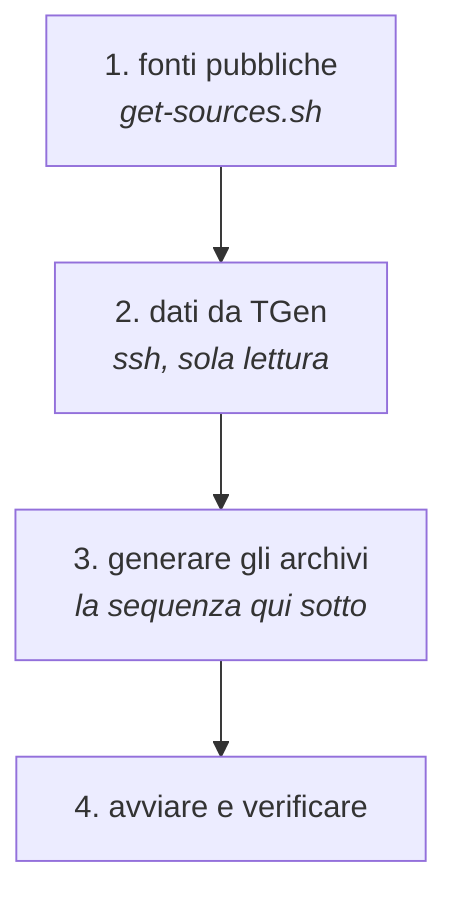
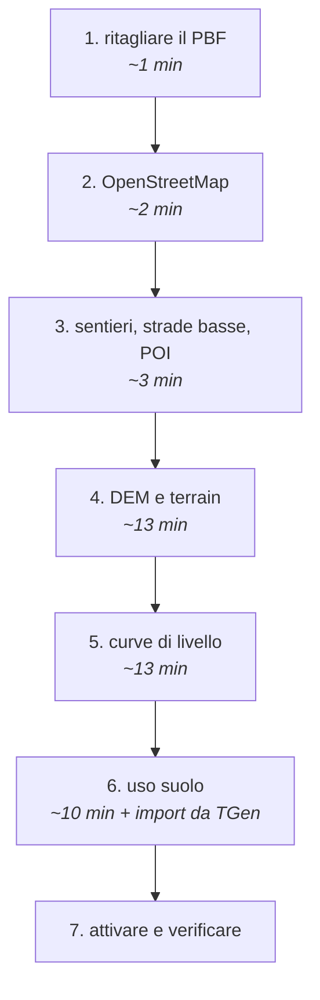
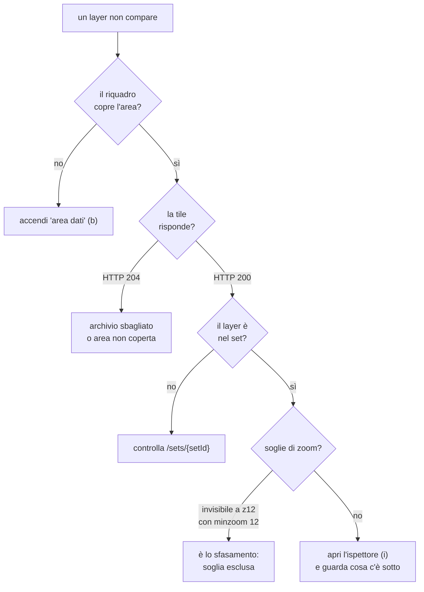

# Runbook — far girare wm-tiles

Operazioni pratiche: avviare, rigenerare un'area, capire perché qualcosa non
si vede.

---

## Avviare

```bash
npm install
node src/server.js          # http://localhost:8080
open http://localhost:8080/preview/
```

Verifiche rapide:

```bash
curl -s localhost:8080/health              # stato
curl -s localhost:8080/version | jq        # quali dati sta servendo
curl -s localhost:8080/manifest | jq       # gruppi disponibili
```

I dati stanno in `data/`, **fuori dal repo**: un clone appena fatto non ha
archivi e la mappa è vuota. È il comportamento atteso, non un guasto.

---

## Preparare un server

Il server di produzione è una macchina Hetzner Cloud (`ssh wm-tiles`): Ubuntu
26.04, 8 vCPU dedicate, 32 GB di RAM, un Volume da 500 GB per i dati. Si
prepara con uno script solo, che si può rilanciare:

```bash
ssh wm-tiles 'bash -s' < infra/prepara-server.sh
```

Installa Docker, Node, aws CLI e gli strumenti che le pipeline chiamano sul
sistema (osmium, tippecanoe 2.79 compilato dai sorgenti, pmtiles), aggiunge
8 GB di swap, lascia SSH solo con chiave e apre nel firewall le sole porte
22, 80 e 443. Il repo sta in `/srv/wm-tiles`, e il suo `data/` punta al Volume
(`/data/wm-tiles`).

Tre cose da sapere:

- **Il Volume è un disco di rete, più lento di quello locale**: ci stanno i
  dati che restano (archivi, PNG, copia da TGen, DEM); i lavori temporanei e
  pesanti si fanno sul disco locale. I backup di Hetzner non coprono il Volume:
  la copia da TGen va salvata anche altrove.
- **Docker scavalca il firewall** per le porte che un container pubblica: un
  servizio in container (GraphHopper) si pubblica su `127.0.0.1` e si espone
  dal reverse proxy.
- **maplibre-native gira solo nel container** (`render-png-docker.sh`): il
  binario precompilato vuole le librerie di Ubuntu 22.04, e `aggiorna-png.sh`
  ci passa da solo.

---

## Ripopolare da zero, dopo un clone

`data/` sta fuori da git: un clone appena fatto non ha dati e la mappa è
vuota. Con accesso a TGen si rimette in piedi tutto.

**Prerequisiti**: Docker, Node ≥ 18, `osmium`, `tippecanoe`, `pmtiles`, `jq`.
Su macOS: `brew install osmium-tool tippecanoe pmtiles jq`.



### 1. Le fonti pubbliche

```bash
bash pipeline/get-sources.sh 10.0 43.62 10.9 44.5
```

Scarica, saltando ciò che c'è già:

| cosa | da dove |
|---|---|
| estratti OSM | `download.geofabrik.de/europe/italy/` — `centro` e `nord-est` |
| DEM Copernicus GLO-30 | `copernicus-dem-30m.s3.amazonaws.com` |
| ESA WorldCover 2021 | `esa-worldcover.s3.eu-central-1.amazonaws.com` |
| glifi dei font | `github.com/openmaptiles/fonts` release v2.0 |

Le sorgenti ausiliarie di planetiler (Natural Earth, water polygons,
lake centerlines) le scarica planetiler stesso al primo giro.

### 2. I dati che vivono su TGen

Servono l'accesso a `ssh tgen` e il rispetto della **sola lettura** — vedi
[`import-da-tgen.md`](import-da-tgen.md) per la regola completa.

**Uso suolo regionale.** Le query ci sono, basta adattare l'envelope:

```bash
ssh tgen "psql -d general -Atf -" < pipeline/sql/usotoscana-bbox.sql   > data/usotoscana.geojsonl
tippecanoe -o /tmp/lc.mbtiles -l landcover -Z8 -z14   --drop-densest-as-needed --simplification=4 --force -q data/usotoscana.geojsonl
pmtiles convert /tmp/lc.mbtiles data/archives/$V/landcover.pmtiles
```

Per un'altra regione serve una query nuova: i nomi reali delle tabelle e la
traduzione delle colonne in `coduso` stanno nelle espressioni `CASE` di
`data/tgen-style/project.mml`.

> **Le query per Corine, toponimi e rifugi non sono nel repo.** Quegli
> archivi furono importati con query scritte al momento e non salvate — gli
> archivi esistono ma la procedura per rifarli va ricostruita. Le tabelle si
> trovano nel `project.mml`: `clc` (`clc12_version_18_5`) per il Corine, e i
> layer dei toponimi e dei rifugi per gli altri due. **Chi rifà una di queste
> importazioni salvi la query in `pipeline/sql/`.**

Nel frattempo, per un'area dentro il riquadro già coperto, si copiano
dall'archivio esistente: `clc`, `toponimi` e `rifugi` hanno un riquadro quasi
nazionale.

### 3-4. Generare e avviare

La sequenza è quella della sezione seguente. Poi:

```bash
node src/server.js &
curl -s localhost:8080/version | jq .provenance
open http://localhost:8080/preview/
```

---

## Rigenerare i dati di un'area



I tempi sono misurati su **0,9° × 0,88° (~7.000 km²)**. I passi 4-6 si possono
lanciare in parallelo: in tutto **circa 40 minuti**.

### 1. Ritagliare il PBF

Gli estratti Geofabrik seguono i **confini amministrativi**: un riquadro a
cavallo di due regioni ne richiede due, altrimenti metà area resta vuota.

```bash
bash pipeline/merge-extracts.sh <W> <S> <E> <N> data/sources/area.osm.pbf \
  data/sources/centro.osm.pbf data/sources/nord-est.osm.pbf
```

### 2-3. OpenStreetMap, sentieri, strade, POI

```bash
V=$(date +%Y%m%d-%H%M); mkdir -p data/archives/$V

bash pipeline/build-osm.sh data/sources/area.osm.pbf data/archives/$V 14
bash pipeline/build-hiking-full.sh  data/sources/area.osm.pbf <W> <S> <E> <N> data/archives/$V/hiking.pmtiles 10 14
bash pipeline/build-roads-lowzoom.sh data/sources/area.osm.pbf <W> <S> <E> <N> data/archives/$V/roadslz.pmtiles 8 11
bash pipeline/build-osmpoi.sh       data/sources/area.osm.pbf <W> <S> <E> <N> data/archives/$V/osmpoi.pmtiles 11 14
```

### 4. DEM

Il mosaico va costruito con `-r cubicspline` **anche su `gdalbuildvrt`**: con
`-resolution highest` il VRT assume la risoluzione del riquadro più fine e
ricampiona il DEM di base col default `nearest`, duplicando le quote. I
gradini che ne escono diventano un reticolo nell'ombreggiatura.

```bash
docker run --rm -v "$PWD/data":/work -v "$PWD/pipeline":/pipeline \
  --entrypoint bash ghcr.io/osgeo/gdal:ubuntu-small-latest -c '
    cd /work
    gdalbuildvrt -overwrite -q -resolution highest -r cubicspline \
      dem_mosaic.vrt dem-src/*.tif dem-hr/*_4326.tif
    gdalwarp -overwrite -q -t_srs EPSG:3857 -r cubicspline -multi \
      -te_srs EPSG:4326 -te <W> <S> <E> <N> \
      -co COMPRESS=DEFLATE -co BIGTIFF=IF_SAFER dem_mosaic.vrt dem3857.tif
    bash /pipeline/build-terrain-zoom.sh /work 8 16'
mv data/terrain-nuovo data/dem/terrain
```

### 5. Curve di livello

```bash
bash pipeline/build-contours-tipizzate.sh data/dem3857.tif \
  data/archives/dem/contours.pmtiles
```

> Il server apre **`contours.pmtiles`**, non `contours-tgen.pmtiles`.
> Sostituendo il secondo le tile rispondono `HTTP 204` e le curve spariscono
> dalla mappa **senza alcun errore**.

### 6. Uso suolo

Il regionale va riletto da TGen — vedi [`import-da-tgen.md`](import-da-tgen.md).
Corine, toponimi e rifugi hanno un riquadro quasi nazionale: si copiano
dall'archivio precedente.

### 7. Attivare

```bash
# aggiornare lo scope in data/archives/$V/provenance.json
pkill -f "node.*src/server"; node src/server.js &
curl -s localhost:8080/version | jq .provenance.scope
```

---

## Aggiungere un'area alla preview

In `manifest/layers.v1.json`, sotto `previewAreas`:

```json
{ "id": "montepisano", "label": "Monte Pisano (Monte Serra)",
  "center": [10.5533, 43.7581], "zoom": 13 }
```

Accendere **area dati** (tasto `b`) per vedere se il punto cade dentro il
riquadro generato: un'area fuori copertura mostra un pannello vuoto accanto a
un riferimento pieno, e sembra un difetto di stile.

---

## Modificare lo stile

> **Non modificare `style/webmapp.json`: è generato.** Le modifiche si perdono
> alla prima rigenerazione.

```bash
# si toccano questi due:
#   style/zoom-profile.json   quali layer per zoom, parametri per livello
#   style/base-layers.json    struttura dei layer (source, filtri, paint)
npm run style && npm run validate
```

Le soglie di zoom si scrivono **nominali**, come nel CartoCSS: la correzione
dello sfasamento la applica `scalaZoom()` in `build-style.mjs`.

---

## Quando qualcosa non si vede



**Il riquadro degli errori.** La preview mostra gli errori dello stile in un
pannello rosso in basso, che negli screenshot di misura viene nascosto. Se
qualcosa non torna, guardalo: un'eccezione in `applyStyle` toglie un intero
layer senza altri segnali. `tile-diff.mjs` ora lo legge e lo riporta.

**Verificare che un parametro sia arrivato a destinazione**, prima di
cambiarne il valore. Tre volte in un giorno un parametro *sembrava*
configurato e non lo era: una funzione mai definita, un `mix-blend-mode`
sovrascritto da `ol.css`, un layer rimosso e mai reinserito. Conta i pixel di
un colore noto, leggi il `getComputedStyle`, elenca i layer della mappa.

---

## Verificare la somiglianza

```bash
node tools/tile-diff.mjs 14/8662/5941      # una tile, i due lati
node tools/element-diff.mjs 10.34,44.25    # per elemento, su più zoom
node tools/ombra-vs-gdal.mjs 16            # l'ombra contro gdaldem
node tools/ombra-scala.mjs                 # l'ombra su un punto, tutti gli zoom
node tools/oltre-z16.mjs 16 17 18 19       # oltre il riferimento non sparisce nulla
node tools/avvio-check.mjs                 # l'avvio non "lampeggia"
npx vitest run                             # i test unitari
```

**Il riferimento raster arriva a z16**: oltre, `tile-diff` si rifiuta di
misurare, perché confronterebbe con un ingrandimento.

---

## Spazio e tempi, per pianificare

| | area di prova (7.000 km²) | Italia (43× la terraferma) |
|---|---|---|
| archivi vettoriali | ~200 MB | ~6 GB |
| DEM fino a **z16** | 3,1 GB | **~130 GB** |
| DEM fino a **z14** | ~200 MB | **~8 GB** |
| tempo totale | ~40 min | 12-15 h (z16) · 4-6 h (z14) |

**Il DEM fino a z14 è la scelta ragionevole**: l'ombreggiatura ai livelli
superiori regge bene l'overzoom, da quando le quote si decodificano in
virgola mobile.

Sono stime estrapolate da **una sola area montuosa**: la pianura ha molte
meno curve di livello, la montagna di più.

---

## Tile PNG su S3 e CloudFront

**Fatto l'11 ottobre 2026.** Le tile PNG stanno nel bucket S3 privato
`wm-tiles-png`, che legge solo CloudFront, nell'account AWS degli shard
(061490227874), regione `eu-central-1`. Tutto e' in
[`infra/tiles-png.yaml`](../infra/tiles-png.yaml), stack `wm-tiles-png`, con
le ragioni di ogni scelta. I nomi delle risorse AWS sono in inglese.

| cosa | valore |
|---|---|
| dominio | `tiles.maphub.it` (certificato ACM in us-east-1, gia' emesso) |
| distribuzione CloudFront | `E1AR48NAFQPA3F`, oggi su `d2ktl89gliikkx.cloudfront.net` |
| bucket | `wm-tiles-png` |
| chi consegna | utente IAM `wm-tiles-delivery`, policy `wm-tiles-png-delivery` |
| la sua chiave | solo sul server wm-tiles, `/root/.aws/credentials`, profilo `wm-tiles-delivery` |
| chi amministra | profilo `wm-admin` sul Mac (utente `wm-admin-cli`), solo per cambiare lo stack |

**Un solo dominio per tutte le tile.** CloudFront smista per percorso:
`/png/*` va al bucket, tutto il resto (tile vettoriali, `style.json`,
manifest, DEM) al server wm-tiles con il nome tecnico
`origine.tiles.maphub.it`, che le app non vedono mai.

**Le cartelle dei PNG** hanno gia' il prefisso `png/` nella chiave, quindi il
percorso arriva a S3 cosi' com'e':

```
png/default/{z}/{x}/{y}.png           tutte le app (l'unica prodotta oggi)
png/{shard}/default/{z}/{x}/{y}.png   tutte le app di uno shard
png/{shard}/{app}/{z}/{x}/{y}.png     una app sola
```

`default` e' un nome riservato. Quale cartella usa un'app lo dice lo shard
nella configurazione che le passa: CloudFront non ripiega da solo su
`default`, perche' una tile che manca davvero (fuori dall'Italia) diventerebbe
in silenzio una tile di un'altra cartella. Ogni cartella e' un'Italia intera da
rendere: due app con la stessa personalizzazione ne condividono una.

Nessuna versione dei dati nel percorso dei PNG, a differenza delle tile
vettoriali: si sovrascrive e si torna indietro con il versioning del bucket.

**Le tile di `api.webmapp.it` non si migrano** (decisione dell'utente): nel
bucket vanno solo i PNG prodotti da wm-tiles. `migra-tiles-s3.sh` resta per
il caso in cui servisse.

### Consegna

Dal server, con il profilo di consegna:

```bash
AWS_PROFILE=wm-tiles-delivery WM_CLOUDFRONT_ID=E1AR48NAFQPA3F \
  bash pipeline/consegna-png.sh <cartella-png> s3://wm-tiles-png/png/default <registro>
```

Ogni consegna carica le tile, invalida in CloudFront quelle cambiate e lascia
nel registro elenco e ora; per tornare indietro,
`pipeline/ripristina-png-s3.sh` riporta quelle tile alla versione precedente,
che il versioning conserva per 60 giorni.

### `tiles.maphub.it` su CloudFront

**Fatto l'11 ottobre 2026.** Sul DNS di maphub.it (dnsitalia.net):

| record | tipo | valore |
|---|---|---|
| `tiles` | CNAME | `d2ktl89gliikkx.cloudfront.net.` |
| `origine.tiles` | A | `116.202.26.149` (il server) |
| `_c0afe18c67178c1b4c548f1a224530a6.tiles` | CNAME | validazione ACM: resta, serve ai rinnovi |

Sul server: `origine.tiles.maphub.it` sta nello stesso blocco del Caddyfile di
`tiles.maphub.it` (copia di prima in `/etc/caddy/Caddyfile.prima-cloudfront`),
e l'unit `wm-tiles` ha `PUBLIC_URL=https://tiles.maphub.it` in
`/etc/systemd/system/wm-tiles.service.d/public-url.conf`: CloudFront chiede
all'origine con `Host: origine.tiles.maphub.it`, e senza la variabile
`style.json` manderebbe i client direttamente al server, scavalcando la cache.

Per tornare indietro: il record `tiles` ridiventa A verso `116.202.26.149`.

Ancora da fare: togliere `tiles.maphub.it` dal blocco di Caddy. Non riceve
piu' traffico e il suo certificato non si rinnova piu' (la sfida HTTP-01
arriva a CloudFront): Caddy ritenterebbe all'infinito.

Un 404 resta nella cache di CloudFront cinque minuti: dopo aver aggiunto
qualcosa che prima mancava (glifi, DEM), si invalida
(`aws cloudfront create-invalidation --distribution-id E1AR48NAFQPA3F --paths '/glyphs/*'`).

### Ricostruire da zero

```bash
# certificato: CloudFront lo legge solo da us-east-1; la validazione chiede un
# CNAME sul DNS di maphub.it (dnsitalia.net), da lasciare per i rinnovi
aws acm request-certificate --profile wm-admin --region us-east-1 \
  --domain-name tiles.maphub.it --validation-method DNS
aws cloudformation deploy --profile wm-admin --region eu-central-1 \
  --stack-name wm-tiles-png --template-file infra/tiles-png.yaml \
  --capabilities CAPABILITY_NAMED_IAM \
  --parameter-overrides NomeBucket=wm-tiles-png CertificatoArn=<arn>
# la chiave di consegna va dritta sul server, senza passare da schermo o file
aws iam create-access-key --profile wm-admin --user-name wm-tiles-delivery --output json \
  | ssh wm-tiles '<scrive il profilo wm-tiles-delivery in /root/.aws/credentials>'
# verifica
curl -sI https://tiles.maphub.it/png/default/14/8669/5973.png   # 200, image/png, CORS
curl -sI https://tiles.maphub.it/png/default/18/1/1.png          # 404
```

**Cosa garantisce la configurazione**, e perche':

- **niente bucket pubblico**: legge solo questa distribuzione (Origin Access
  Control);
- **chi consegna non puo' cancellare**: solo scrittura e invalidazione
  (verificato: `aws s3 rm` dal server risponde AccessDenied);
- **una tile mancante risponde 404**, come oggi, e il 404 resta in cache
  cinque minuti;
- **cache**: il browser tiene una tile 7 giorni, come oggi; CloudFront un anno,
  perche' ogni consegna invalida cio' che cambia. Le prime 1.000 invalidazioni al
  mese sono gratuite, e sopra le 1.000 tile se ne fa una sola su tutto;
  le risposte del server seguono le sue intestazioni (`immutable` le tile
  vettoriali, `no-cache` stile e manifest);
- **CORS aperto** (`Access-Control-Allow-Origin: *`), come oggi: OpenLayers
  carica le tile in modo da poterne leggere i pixel;
- **il bucket sopravvive allo stack**: cancellare lo stack non cancella le tile.

---

## Riferimenti

- come funziona: [`wm-tiles.md`](wm-tiles.md)
- il sistema attuale: [`tgen.md`](tgen.md)
- leggere da TGen: [`import-da-tgen.md`](import-da-tgen.md)
- contratto per le app: [`integrazione.md`](integrazione.md)
- trappole e vincoli, per chi lavora al codice: `CLAUDE.md`
