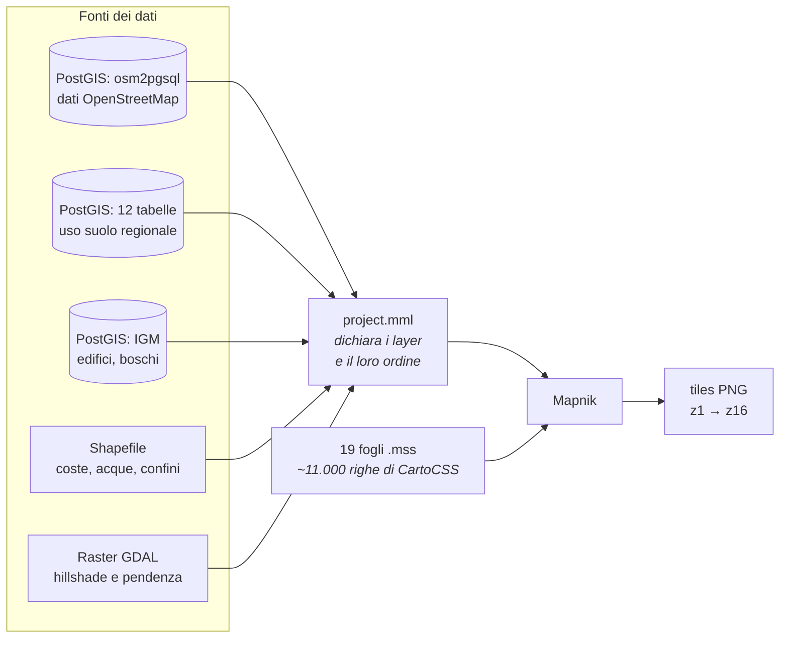
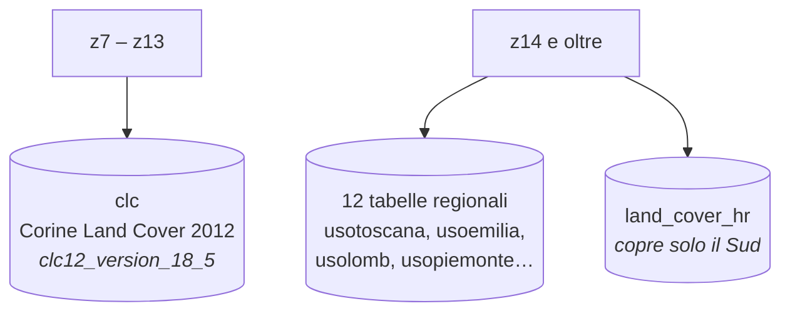
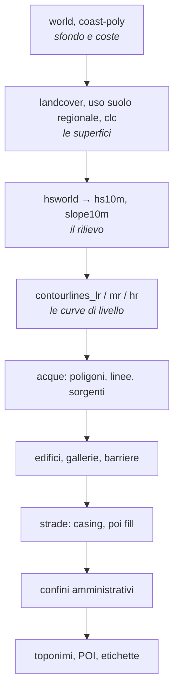

# TGen — come funziona il sistema cartografico attuale

> **Cosa sia questo documento.** TGen non ha una documentazione propria: quanto
> segue è stato **dedotto leggendo** `project.mml`, i fogli `.mss` e lo schema
> del database, tutto scaricato in sola lettura. Descrive com'è *configurato*
> il sistema, non come viene messo in esercizio: la sequenza di rigenerazione,
> la schedulazione e il deploy non sono documentati qui perché non li abbiamo
> osservati.
>
> Aggiornato al 5 settembre 2026. I file letti stanno in `data/tgen-style/`.

TGen è il sistema che produce le tiles raster servite oggi da
`https://api.webmapp.it/tiles/{z}/{x}/{y}.png`. È un **Mapnik + CartoCSS**
classico: un database PostGIS con i dati, un progetto che dichiara i layer, e
fogli di stile che ne descrivono l'aspetto. Il risultato sono immagini PNG
pre-renderizzate.

---

## Il quadro d'insieme



**Le tiles si fermano a z16.** Da z17 in su il server risponde `404` e il
client mostra la z16 ingrandita: i toponimi sembrano più grandi e le icone
enormi, ma è sfocatura, non stile.

---

## Da dove vengono i dati

I 117 layer del progetto attingono a quattro tipi di sorgente:

| tipo | quanti | cosa |
|---|---|---|
| **PostGIS** (`osm2pgsql`) | 78 | il grosso: strade, edifici, acque, toponimi, POI |
| **PostGIS** (tabelle proprie) | 28 | uso suolo regionale, dati IGM, curve di livello |
| **Shapefile** | 6 | coste, poligoni d'acqua, confini di stato |
| **Raster GDAL** | 5 | ombreggiatura e pendenza, pre-calcolate |

I 78 layer OpenStreetMap ereditano la connessione da un'unica ancora YAML
(`&osm2pgsql`, database `gis`), quindi nel `.mml` non ripetono i parametri.

### L'uso suolo cambia fonte con lo zoom

È la cosa meno ovvia dell'intero sistema, e va saputa prima di toccare
qualunque cosa riguardi le superfici.



Le tabelle regionali hanno **nomi diversi da quelli del `.mml`**
(`usotoscana` → `usotoscana2013`, `usoemilia` → `uso_emilia_2008`) e
**colonne diverse** fra loro (`lv3_13`, `cod_tot`, `ur_cd`, `cod_uso`…). Il
`.mml` le normalizza con lunghe espressioni `CASE` in un unico campo
`coduso`, che è quello su cui lo stile sceglie i colori.

Il CLC e le tabelle regionali usano **le stesse variabili di colore**
(`@bosco`, `@pascolo`, `@arbusti`…): cambia la fonte dei poligoni, non la
palette.

---

## Il rilievo: tre DEM, non uno

L'ombreggiatura **non viene calcolata al momento**: è una serie di raster
grigi prodotti offline con `gdaldem` e serviti come immagini.

| layer | zoom | sorgente | opacità | composizione |
|---|---|---|---|---|
| `hsworld` | z1–z6 | `hs/world/SR_HR.tif` | 0,2 | multiply |
| `hs100m` | z7–z10 | DEM **100 m** | 0,2 | multiply |
| `hs25m` | z11–z13 | DEM **25 m** | 0,18 | multiply |
| `hs10m` | z14+ | DEM **10 m** | 0,3 | *nessuna* (normale) |
| `slope10m` | z14+ | pendenza a 10 m | 0,15 | **overlay** |

Tre osservazioni che contano:

1. **La risoluzione del DEM cambia per fascia di zoom.** Non si ingrandisce
   un dato unico: ogni fascia ha il suo, adatto alla scala.
2. **`hs10m` non ha `comp-op`**: da z14 in su l'ombra è composta in modo
   *normale*, non in multiply come alle fasce basse.
3. Tutti usano `raster-scaling: lanczos` — un filtro che leviga il risultato.
   È possibile perché un'immagine grigia si può interpolare senza problemi.

Le curve di livello seguono lo stesso schema, con tre layer e tre densità:
`contourlines_lr` a z12, `contourlines_mr` a z13, `contourlines_hr` da z14.
Portano i campi `quota` e `type`, dove `type` distingue le direttrici
(`cp25`, `cp50`) dalle secondarie (`cs25`, `cs50`).

---

## Lo stile: 19 fogli, ~11.000 righe

`project.mml` elenca i fogli **in ordine**, e l'ordine conta: in CartoCSS
l'ultima definizione di una variabile vince.

```
webmapp.mss  ← la palette: @bosco, @acquefondo, @admin-boundaries…
hiking_trails.mss
style.mss
fonts.mss
shapefiles.mss
landcover.mss
water.mss  water-features.mss
road-colors-generated.mss  ← i colori delle strade
roads.mss                  ← 3.165 righe, il foglio più grande
power.mss
placenames.mss
buildings.mss
stations.mss
amenity-points.mss         ← 3.007 righe
ferry-routes.mss  aerialways.mss  admin.mss  addressing.mss
```

**Attenzione ai duplicati.** Esistono varianti dello stesso foglio
(`road-colors-no-hiking.mss`, `landcover_blanckmap.mss`, file con la data nel
nome): leggere quello sbagliato porta a conclusioni sbagliate. Vale solo
quanto è elencato in `project.mml`. E alcune variabili sono definite **due
volte** nello stesso foglio — `@parking` e `@military` in `webmapp.mss` —
dove vince la seconda.

---

## L'ordine di disegno

I layer si disegnano nell'ordine del `.mml`: il primo sta sotto, l'ultimo
sopra.



Il rilievo sta **sotto** le curve di livello e le strade, non sopra: è la
ragione per cui in TGen le strade bianche restano bianche anche sui versanti
in ombra.

---

## Cosa non abbiamo osservato

Per onestà, i limiti di questo documento:

- **Come si rigenerano le tiles.** Sappiamo che il rendering dell'Italia
  richiese circa dieci giorni e che l'aggiornamento continuo da OSM è spento,
  ma non abbiamo visto la procedura.
- **Come i raster di ombreggiatura vengono prodotti.** I `.vrt` in
  `/root/mapdata/` sono mosaici già pronti; i parametri di `gdaldem` usati per
  generarli non sono nei file che abbiamo letto.
- **Il deploy e la schedulazione.**
- **Due layer esistono ma non sono in produzione**: `names_along_lines` e
  `rifugi_bivacchi` non hanno riferimenti in `.mml` o `.mss` — asset pronti e
  mai attivati.

---

## Vincolo operativo

**TGen è un server di produzione e per noi è in sola lettura.** Sono ammessi
solo `SELECT`, `COPY … TO STDOUT` e `tar cf -` su stdout. Nessuna scrittura,
nessun file creato là, nessun servizio riavviato, nessuna query salvata sul
server — le query si passano da stdin.

Come si legge da TGen è descritto in [`import-da-tgen.md`](import-da-tgen.md).
