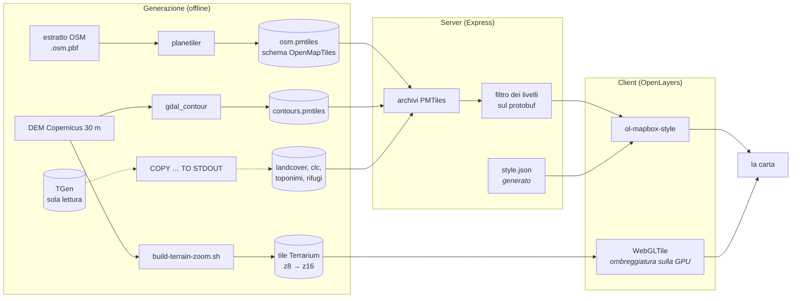
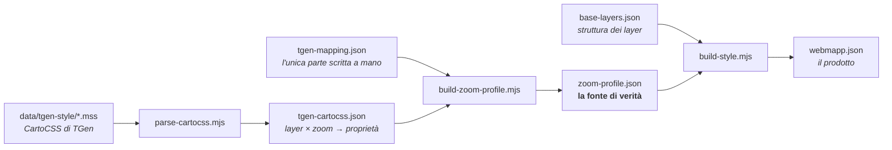
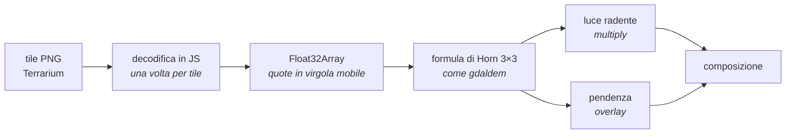

# wm-tiles — come funziona

Server di tiles **vettoriali** da OpenStreetMap, con uno stile che riproduce
l'aspetto delle tiles raster attuali di [TGen](tgen.md). Sostituisce
`api.webmapp.it/tiles/{z}/{x}/{y}.png` con dati vettoriali che il client
disegna, mantenendo la stessa carta.

> Aggiornato al 5 settembre 2026. L'area generata copre l'Appennino
> Tosco-Emiliano e il Monte Pisano; la pipeline nazionale non è ancora stata
> eseguita.

---

## Perché vettoriale

| | raster (TGen) | vettoriale (wm-tiles) |
|---|---|---|
| chi disegna | il server, una volta per tutte | il client, a ogni vista |
| personalizzazione per app | nessuna: l'immagine è cotta | i livelli si accendono e spengono |
| zoom intermedi | sgranano | nitidi a qualunque scala |
| peso | ~10 GB/Italia di PNG | ~1 GB di tile vettoriali |
| rigenerazione | ~10 giorni | ore |

Il prezzo è che **lo stile va riprodotto**: le tiles PNG contengono già i
colori, le vettoriali no.

---

## Il flusso, dall'origine allo schermo



---

## Il server

Un Express che fa quattro cose.

**Serve le tile** da archivi PMTiles, un file per gruppo di dati:

```
/t/:versione/:set/:archivio/:z/:x/:y.pbf
```

**Filtra i livelli sul protobuf.** È il pezzo che rende wm-tiles utile agli
shard: un'app che mostra 5 livelli su 8 riceve tile con dentro solo quei 5,
non tutto il contenuto con il resto nascosto lato client. Il filtro lavora
**sui byte del protobuf**, senza decodificare e ricodificare le geometrie:
è senza perdita e veloce.

**Genera lo `style.json`** con gli URL corretti per l'istanza, e serve sprite
e glifi.

**Espone la preview** di confronto affiancato con il riferimento raster.

| rotta | cosa fa |
|---|---|
| `/health`, `/version` | stato e provenienza dei dati |
| `/manifest`, `/sets/:set` | gruppi di livelli disponibili |
| `/style.json` | lo stile, con gli URL dell'istanza |
| `/t/…/:z/:x/:y.pbf` | le tile vettoriali, filtrate |
| `/dem/terrain/…` | le tile del DEM (quote, non colori) |
| `/sprite/v:n/…`, `/glyphs/…` | icone e font |
| `/preview/` | il confronto affiancato |
| `/inspect/…` | contenuto di una tile, per capire cosa c'è dentro |

Lo sprite ha l'**URL versionato nel percorso** (`/sprite/v1234/`): cambiare
l'header `Cache-Control` non basta, perché una copia già memorizzata dal
browser resta valida — e per un giorno abbiamo inseguito icone che non
comparivano.

---

## Lo stile è generato, non scritto

**`style/webmapp.json` è un file prodotto: modificarlo a mano significa
perderne le modifiche alla prima rigenerazione.**



```bash
npm run cartocss   # dai .mss alla tabella delle proprietà
npm run profile    # + mapping → zoom-profile.json
npm run style      # + base-layers.json → webmapp.json
npm run validate
```

### `zoom-profile.json`, la fonte di verità

Per **ogni livello di zoom** dichiara quali layer si vedono, in che ordine, e
quale set di parametri usano:

```jsonc
"14": {
  "shade": "hs-z14",        // il set di ombreggiatura
  "surfaces": "regionale",  // quale palette per le superfici
  "visible": ["background", "landcover-fill", "contour", …]
}
```

Il riferimento cambia per fascia **quasi ogni parametro**: tenerli sparsi nei
singoli layer significa correggere un livello e romperne un altro. Per la
stessa ragione **ogni zoom ha il suo set di ombreggiatura** (`hs-z8` …
`hs-z16`): le opacità che ne risultano non seguono una curva liscia, e nessuna
fascia condivisa potrebbe rappresentarle.

### Due regole che non si deducono dal codice

**Le soglie di zoom nei sorgenti sono quelle nominali del CartoCSS.**
`ol-mapbox-style` le valuta sfasate di un livello — una soglia scritta `12` fa
scattare il valore a vista z13 — e la correzione si applica in un punto solo,
`scalaZoom()` dentro `build-style.mjs`.

**Un layer OpenMapTiles va filtrato come lo filtra il CartoCSS.** Prenderne
uno e disegnarlo intero mentre TGen ne seleziona una parte non produce un
colore diverso: produce roba in più sulla mappa. È successo tre volte, con
`landuse-park`, `park-band` e `park-label`.

---

## L'ombreggiatura

È l'unica parte calcolata sul client, e la più delicata. Il DEM arriva come
tile PNG in formato **Terrarium** (`quota = R·256 + G + B/256`), e un layer
`WebGLTile` calcola il rilievo sulla GPU.



**Perché la decodifica in JavaScript**: la GPU interpola le texture, e nel
formato Terrarium il canale blu avvolge a ogni metro di dislivello — a ogni
giro l'interpolazione produce un valore privo di senso, e su un versante
regolare quei giri disegnano strisce parallele alle curve di livello. Con le
quote in virgola mobile l'interpolazione è invece **necessaria**, perché oltre
il maxzoom del DEM smussa i bordi dei texel.

Il calcolo è verificato contro `gdaldem`: la correlazione è **0,998**.

`tools/ombra-vs-gdal.mjs` è il metro oggettivo — una correlazione negativa
significa ombra invertita, cioè vette che si leggono come valli, e nessuna
metrica globale se ne accorge.

---

## La preview

Il confronto affiancato con il riferimento raster, a `/preview/`.

- **interruttori per ogni layer** — 44 a z19, uno per layer di stile
- **ombreggiatura** e **pendenza**: non sono layer dello stile, hanno
  interruttori propri
- **griglia XYZ** (`g`): nomina una differenza invece di descriverla —
  `14/8663/5939` invece di «in alto a destra del crinale»
- **area dati** (`b`): il riquadro rosso dell'area generata, letto da
  `/version`. Fuori da lì le tile vettoriali non esistono mentre il
  riferimento risponde comunque, e la differenza sembra un difetto di stile
- **ispettore** (`i`): al clic dice quale layer c'è sotto il cursore, con
  attributi e colori a confronto

---

## Come si misura la somiglianza

Le medie globali (Δ luminosità, Δ contrasto) sono un indicatore grossolano:
risentono del contenuto, e **il contenuto diverge per costruzione** perché le
tiles di riferimento sono ferme da mesi mentre OSM è andato avanti.

Si confronta **come sono disegnate le cose presenti in entrambi**: colore,
larghezza, dimensione dei simboli, soglie di zoom.

```bash
node tools/tile-diff.mjs 14/8662/5941    # una tile, i due lati a confronto
node tools/element-diff.mjs 10.34,44.25  # per elemento, su più zoom
node tools/layer-contrib.mjs 10/541/371  # quanto contrasto aggiunge ogni layer
node tools/ombra-scala.mjs               # l'ombra su un punto fisso, tutti gli zoom
```

Stato attuale sull'area di validazione: **luminosità entro ±2,5 e contrasto
entro ±1,8** su tutta la scala z10–z16.

---

## Cosa manca

- **renderer raster**, per i client che non reggono il vettoriale
- **pipeline nazionale**: oggi l'area è l'Appennino Tosco-Emiliano più il
  Monte Pisano
- **rigenerazione settimanale e on-demand su bbox**
- **connettore `map-core`** (richiede `ol` ≥ 7.3.0; oggi è pinnato a 7.1.0)
- **osservabilità e metriche**

Per generare i dati di un'area nuova, vedi il runbook. Per leggere da TGen,
[`import-da-tgen.md`](import-da-tgen.md).
